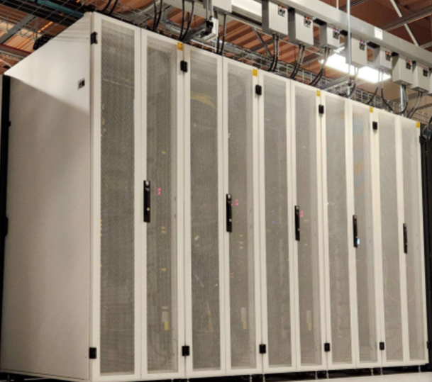

# Welcome to the University of Iowa HPC Documentation Site
<link rel="stylesheet" href="./assets/stylesheets/extra.css">
<link rel="stylesheet" href="assets/stylesheets/images.css">

## Introduction

The University of Iowa (UI) supports UI researchers and their external collaborators by providing access to advanced supercomputing resources. Information Technology Services (ITS) operates several key systems, including the **Argon High Performance Computing(HPC) cluster**, the **Interactive Data Analytic Service(IDAS)**, and several types of Storage Services.

In addition to the comprehensive [Argon wiki pages](https://uiowa.atlassian.net/wiki/spaces/hpcdocs/overview?homepageId=76513285), this site is designed to help users effectively utilize HPC resources for computational research projects. If you have any questions or feedback about the content of this site, please contact us using [service portal](https://service.uiowa.edu). 

---

 

<!--
!!! warning "Future Scheduler Migration"

    Argon will migrate its job scheduler from [Sun Grid Engine (SGE)](https://gridscheduler.sourceforge.net/htmlman/manuals.html) to [SLURM](https://slurm.schedmd.com/overview.html). **The exact release date has not yet been determined,** but please start reviewing your submission scripts to see what updates will be needed: [SGE to SLURM on Argon](sge_slurm/index.md)
-->

## News

-   :material-alert-box-outline:{ .lg .middle } __Fall 2026 Argon Maintenance__
 
    ---
    
    * The recurring maintenance is scheduled from **8 AM on November 12th until 8 AM on November 13th**. 

<!--
    * <s>The recurring maintenance is scheduled from **8 AM on August 12th until 8 AM on Augut 13th**.</s> 
    * Completed the summer maintenance successfully.
-->

-   :material-update:{ .lg .middle } __Argon OS and Scheduler Update__

    ---

    * The transition date has not yet been finalized.
    * Cent OS7 to Rocky 9
    * [SGE to SLURM](/sge_slurm)

-   :material-school:{ .lg .middle } __Fall Semester 2026 Workshops__

    ---

    * <s> [PSC Workshop: OpenMP, MPI, Machine Learning](https://events.uiowa.edu/event/39665): **October 13&14** </s>
    * [Basic Linux Command Line on Argon](https://events.uiowa.edu/event/39983): **December**
    * [Introduction to HPC using Argon](https://events.uiowa.edu/event/39984): **December** 
    
-   :material-comment-account-outline:{ .lg .middle } __Open Office Hours in November 2026__

    ---

    * Monthly open office hours is scheduled in November: the exact date is **TBD**.
    * Topic is general questions about how to utilize Argon for your research. 

<!--
-   :material-database:{ .lg .middle } __Storage Modernization__

    ---

    * Large Scale Storage & Argon Homes from zfs to Ceph
-->

---

## Featured links for Research Services

-  :custom-iowa_hawkeyes_2:{ .lg .middle } [__Argon: High-Performance Computing (HPC)__](https://research.its.uiowa.edu/our-services/computing-services/argon-high-performance-computing-hpc)

    Accounts on the Argon HPC system are available at no cost to UI faculty, staff, and students who conduct research. Faculty members may sponsor access for research collaborators who are not part of the UI community and may purchase dedicated compute node capacity for their groups.

-  :custom-iowa_hawkeyes_2:{ .lg .middle } [__Argon Manual at wiki__](https://uiowa.atlassian.net/wiki/spaces/hpcdocs/overview)

    Comprehensive information about how to utilize Argon cluster

-  :custom-iowa_hawkeyes_2:{ .lg .middle } [__Interactive Data Analytics Services (IDAS)__](https://idas.uiowa.edu/)

    A high performance computing (HPC) resource that supports large-scale and collaborative data analytics workflows involving RStudio, Jupyter Notebooks, and Jupyter Lab.

-  :custom-iowa_hawkeyes_2:{ .lg .middle } [__Storage Service__](https://research.its.uiowa.edu/our-services/storage-services)

    Store and share research data files

---

## Acknowledgements

The Argon HPC cluster at the University of Iowa is a collaboration and as such there are different acknowledgements that may be appropriate for your citation. See our [guidelines](https://research.its.uiowa.edu/our-services/computing-services/argon-high-performance-computing-hpc/citationacknowledgement) for more details.

----
